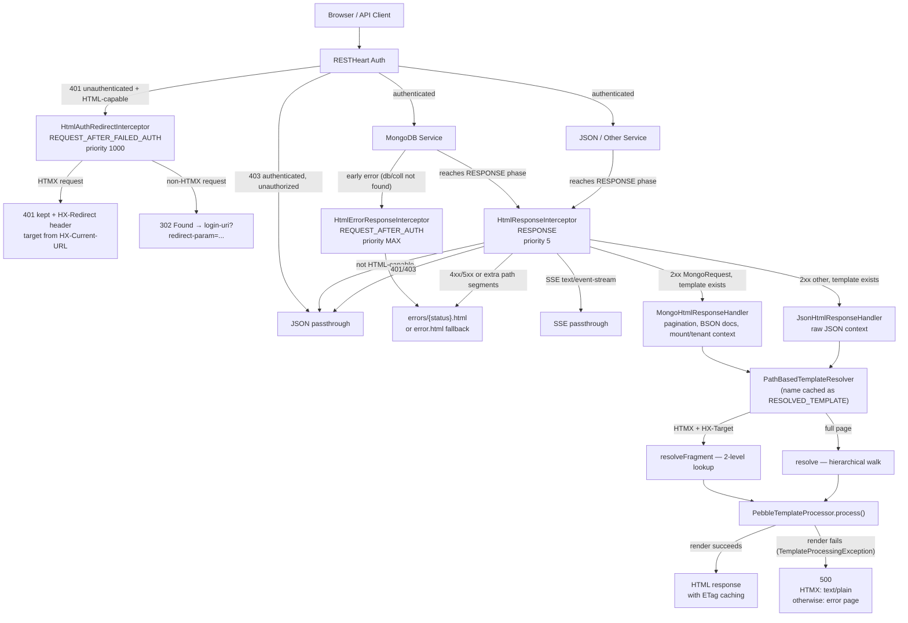

# Facet Architecture

Facet is a [RESTHeart](https://restheart.org) plugin that intercepts HTTP responses and optionally renders them as HTML using path-based Pebble templates. It uses the **interceptor pattern** at the `RESPONSE` phase, with a strategy-based handler chain for different response types. Facet currently targets RESTHeart 9.12.3 (`restheart-commons` and the `softinstigate/restheart` Docker base image); the bump from 9.7.x required no source changes.

## Request Flow



*Request flow from browser through RESTHeart interceptors to HTML rendering, including the HX-Redirect auth-failure path and the 500-on-render-failure path.*

## Plugin Registration

Facet registers four RESTHeart plugins via `@RegisterPlugin` annotations:

| Plugin | Class | Intercept Point | Priority | enabledByDefault | Purpose |
|--------|-------|-----------------|----------|------------------|---------|
| `html-response-interceptor` | `HtmlResponseInterceptor` | `RESPONSE` | 5 | `false` | Main SSR: transforms 2xx and 4xx/5xx to HTML |
| `html-error-response-interceptor` | `HtmlErrorResponseInterceptor` | `REQUEST_AFTER_AUTH` | `MAX` | **`true`** | Catches early errors before RESPONSE phase |
| `html-auth-redirect-interceptor` | `HtmlAuthRedirectInterceptor` | `REQUEST_AFTER_FAILED_AUTH` | 1000 | `false` | Redirects unauthenticated browsers to the login page |
| `login-service` | `LoginService` | N/A (JsonService) | N/A | `false` | Serves login form; dynamically registers auth redirect interceptor |

Only `HtmlErrorResponseInterceptor` is enabled by default. Enable the others in RESTHeart config:

```yaml
/html-response-interceptor:
  enabled: true
  response-caching: false   # disable ETag caching for dev
  max-age: 5                # Cache-Control max-age (seconds)

/html-auth-redirect-interceptor:
  enabled: true
  login-uri: /login
  exclude-paths: [/api, /tokens]  # optional: paths that bypass redirect
  redirect-param: redirect        # optional: query param carrying the original URL (default: "redirect")
  cookie-name: rh_auth            # optional: auth cookie cleared on failure (default: "rh_auth")

/login-service:
  enabled: true
  uri: /login
  redirect-param: redirect   # must match html-auth-redirect-interceptor when both are statically configured
  cookie-name: rh_auth
```

See [operations.md](operations.md) for full configuration reference.

## Dependency Injection

Facet uses RESTHeart's `@Inject` annotation for component wiring:

- **`@Inject("pebble-template-processor")`** — `TemplateProcessor` instance (registered by Pebble plugin)
- **`@Inject("mclient")`** — `MongoClient` for count queries and document metadata
- **`@Inject("config")`** — Plugin configuration map from `restheart.yml`
- **`@Inject("rh-config")`** — the full RESTHeart `Configuration`, used by `HtmlResponseInterceptor` to resolve the MongoDB mount prefix
- **`@Inject("registry")`** — the `PluginsRegistry`, used by `LoginService` to dynamically register `HtmlAuthRedirectInterceptor`

The `@OnInit` method in `HtmlResponseInterceptor` creates the `PathBasedTemplateResolver`, publishes the `mongoPrefix` global template variable, and registers response handlers:

```java
// Expose the MongoDB mount prefix (e.g. "/api" or "/") to all templates
this.templateProcessor.addToGlobalTemplateContext("mongoPrefix", resolveMongoPrefix());

// Handlers are tried in order; first match wins
this.handlers.add(new MongoHtmlResponseHandler(mongoClient, templateProcessor));
this.handlers.add(new JsonHtmlResponseHandler(templateProcessor)); // fallback
```

`resolveMongoPrefix()` calls `MongoMountResolver.resolveMongoPrefixFromConfig(rhConfig)` and normalizes the result (`normalizePrefix()`: ensures a leading slash, strips any trailing slash, defaults to `"/"` when blank or on error). `MongoHtmlResponseHandler` reads this `mongoPrefix` value back out of the global template context to strip the mount prefix from `mongoPath` (see below), so that templates see a stable, mount-independent path even when MongoDB is mounted under e.g. `/api`.

## Response Handler Strategy

`HtmlResponseInterceptor` delegates context building to specialized handlers implementing `HtmlResponseHandler`:

### MongoHtmlResponseHandler

Handles `MongoRequest` instances (RESTHeart's MongoDB service). Builds rich template context including:

- BsonDocument list transformation to JSON
- Pagination: `page`, `pagesize`, `totalPages`, `totalItems`
- MongoDB metadata: `database`, `collection`, `resourceType`
- `mongoPath`: the request path with the configured `mongoPrefix` stripped (and a trailing slash normalized away), so templates don't need to know how MongoDB is mounted
- Mount context (`resolveMountContext()`): mount-resolved `db`, `coll`, permission flags (`canCreateDatabases`, `canCreateCollections`, `canCreateDocuments`, `canDeleteDatabase`, `canDeleteCollection`), `resourceUrl`, and a collection-level `collectionUrl` reset path
- Query parameters: `filter`, `sort`, `keys`
- Document `_id` metadata for URL generation via `IdTypeDetector`
- Tenant context (`addTenantContext()`): `tenantId` (JSON-quoted string or `"null"`), `isMultiTenant` (true only when the resolved mount has parametric segments *and* a tenant id was extracted via `MongoMountResolver.extractTenantId()`), and `hostParams` — a JSON object built by `buildHostnameParamsAsJson()` from the `Host` header, containing `host` (hostname without port) and indexed `host[0]`, `host[1]`, … segments split on `.`, for use in parametric-mount URL construction

Count queries are served from a bounded **Caffeine cache** (`Cache<String, Long>`, 5-second `expireAfterWrite`, max 1000 entries) backing `estimatedDocumentCount()`, `countDocuments(filter)`, `countDatabases()`, and `countCollections()`. Cache keys are built from `db/coll/filter.toJson()` for filtered counts (or a `/__estimated__`, `/__databases__`, `/__collections__` suffix for the other count kinds) rather than from the filter's `hashCode()`, so two different filters can never collide on the same cached count.

Source: [`core/src/main/java/org/facet/html/handlers/MongoHtmlResponseHandler.java`](../core/src/main/java/org/facet/html/handlers/MongoHtmlResponseHandler.java)

### JsonHtmlResponseHandler

Generic fallback for non-MongoDB service responses. Wraps the raw JSON response body in a minimal template context. Always returns `canHandle = true`, so it must be registered last.

Facet's own context variables — `isAuthenticated`, `username`, `roles` (via `withAuthenticatedUser()`), `path`, and `data` (the raw JSON) — are added to the `TemplateContextBuilder` **after** `withServiceData(serviceData)`. Because later `with(...)` calls win on key collision, this ordering guarantees the service's own JSON fields can never shadow Facet-owned variables of the same name (e.g. a service returning its own `username` or `isAuthenticated` field no longer overrides the real authenticated-user context).

Source: [`core/src/main/java/org/facet/html/handlers/JsonHtmlResponseHandler.java`](../core/src/main/java/org/facet/html/handlers/JsonHtmlResponseHandler.java)

### LoginService

`LoginService` is a `JsonService` (not an interceptor) that returns a JSON model for `GET /login`. The `HtmlResponseInterceptor` then renders the model into the `templates/login/index.html` template.

`LoginService` supports `redirect-param` (default `redirect`), `default-redirect` (default `/`), `roles-endpoint` (default `/roles`), and `cookie-name` (default `rh_auth`, matching `HtmlAuthRedirectInterceptor.DEFAULT_COOKIE_NAME`). The requested `redirect` query parameter is validated by `safeRedirect()` before being embedded in the login page model: only a **local absolute path** is honored — a value must start with a single `/` (so `//evil.example` and absolute URLs like `https://evil.example` are rejected) and must contain none of backslash, single/double quote, angle brackets, backtick, whitespace, or control characters (so the value stays safe to embed in a quoted JavaScript string). Any value failing these checks falls back to `default-redirect`, closing an open-redirect vector on the login page.

On initialization, `LoginService` dynamically registers `HtmlAuthRedirectInterceptor` via the plugin registry if no instance is already present, passing its own `redirect-param` and `cookie-name` through to the interceptor's configuration so both components agree on the query parameter name and the cookie to clear. If an `HtmlAuthRedirectInterceptor` is already statically configured, `LoginService` logs a warning reminding the operator to keep `redirect-param`/`cookie-name` in sync manually, and skips registration.

Source: [`core/src/main/java/org/facet/html/LoginService.java`](../core/src/main/java/org/facet/html/LoginService.java)

## Template Resolution

Template lookup is handled by [`PathBasedTemplateResolver`](template-system.md), which is a stateless utility. The resolver is passed the `TemplateProcessor` at call time rather than being injected — this decouples the `html` package from the `templates` package.

`HtmlResponseInterceptor.resolve()` performs the template-existence check for 2xx responses and, when a template is found, caches its name as an exchange attachment (`RESOLVED_TEMPLATE`, an `AttachmentKey<String>`). `handle()` reuses that attachment instead of repeating the (potentially multi-step hierarchical) lookup, falling back to a fresh `resolveTemplateWithType()` call only if the attachment is absent. If the template is found during `resolve()` but fails to render during `handleSuccessResponse()` (a `TemplateProcessingException`, e.g. a Pebble syntax or evaluation error), the interceptor now surfaces this as a **500** via `reportTemplateError()` — plain text (`Template rendering failed: …`) for HTMX requests, or a rendered error page otherwise — rather than silently letting the original JSON response through with a 200 status.

See [template-system.md](template-system.md) for the full resolution algorithm.

## HTMX Awareness

The interceptor detects HTMX requests via `HtmxRequestDetector.isHtmxRequest()`, which checks for `HX-Request: true` header combined with `Accept: */*`. It adjusts rendering accordingly:

- **HTMX + `HX-Target`** → fragment template (strict 2-level lookup via `_fragments/` subdirectories)
- **HTMX without `HX-Target`** → full page template (same as standard browser request)
- **SSE `text/event-stream`** → always bypasses interception

See [htmx.md](htmx.md) for fragment resolution details.

## `resolve()` Success-Path Logic

`HtmlResponseInterceptor.resolve()` decides, per request/response pair, whether the RESPONSE-phase interceptor should transform the output to HTML. The checks run in this order:

1. **SSE bypass** — `isEventStreamRequest(request.getHeaders())` (an `Accept: text/event-stream` request) always short-circuits to `false`, regardless of status code, so RESTHeart's SSE infrastructure is never touched.
2. **HTML capability** — `acceptsHtml(request.getHeaders())` must be true (`Accept: text/html`, or an HTMX request per `HtmxRequestDetector`); otherwise `false`.
3. **401/403 passthrough** — the response status (treating an unset `-1` status as `200`) is checked with `isAccessDenied()`; 401/403 responses are never intercepted here, letting the authentication/authorization challenge pass through unchanged (this is the domain of `HtmlAuthRedirectInterceptor` instead).
4. **Other 4xx/5xx** — any remaining error status returns `true` immediately, so `handle()` renders the error page.
5. **Extra-path-segment 404 detection** — for `MongoRequest`s, `mongoRequest.getResolvedContext().hasExtraPathSegments()` is checked *before* any success-path template lookup; if the resolved mount context says the path has invalid trailing segments, `resolve()` returns `true` so the response is rendered as a 404 regardless of the underlying (possibly cached/200) status.
6. **Template-exists check for success responses** — for 2xx responses, `resolveTemplateWithType(request)` performs an action-aware template lookup (`MongoRequest.getType()`-aware for Mongo requests, path-only otherwise). If a template is found, its name is cached on the exchange as `RESOLVED_TEMPLATE` and `resolve()` returns `true`; otherwise `false` (the original JSON response passes through).

## Mount Context and Tenant Awareness

`MongoHtmlResponseHandler.createTemplateContextBuilder()` builds `mongoPath` by stripping the `mongoPrefix` global template variable (set in `HtmlResponseInterceptor.onInit()`) from the request path via `stripMongoPrefix()`, then normalizing away a trailing slash. `resolveMountContext()` then adds mount-resolved metadata — `db`, `coll` (preferring the resolved `ResolvedContext.database()`/`collection()` over the raw `MongoRequest.getDBName()`/`getCollectionName()` when available), the `canCreate*`/`canDelete*` permission flags from `ResolvedContext`, `resourceUrl` (`ResolvedContext.mongoResourcePath()`), and a `collectionUrl` reset path computed by `getResetPath()` (drops the trailing document segment from `mongoResourcePath()` when the current request targets a single document, so "reset to collection view" links never retain stale pagination/document state).

`addTenantContext()` supports hostname-based parametric mounts (multi-tenant deployments where the Host header selects the database): `tenantId` comes from `MongoMountResolver.extractTenantId(mongoRequest)` and is JSON-quoted (`"tenant"` or the literal `null`) for direct Pebble interpolation; `isMultiTenant` is `true` only when the resolved mount context reports parametric mounts (`hasParametricMounts()`) *and* a tenant id was actually extracted; `hostParams` is a JSON object from `buildHostnameParamsAsJson()` containing the request's `Host` header (port stripped) under `host`, plus each dot-separated label under `host[0]`, `host[1]`, etc., so templates can build tenant-scoped links without re-parsing the Host header themselves.

## Error Handling

Two interceptors cooperate for error rendering, covering different lifecycle phases:

1. **`HtmlErrorResponseInterceptor`** (`REQUEST_AFTER_AUTH`, `Integer.MAX_VALUE` priority) — catches errors that occur *before* the RESPONSE phase. Some services (notably MongoDB) detect errors like database/collection-not-found during `REQUEST_AFTER_AUTH` and terminate the exchange early. This interceptor catches those early errors for HTML-capable browser requests and delegates to `HtmlResponseHelper.renderErrorPage()`.

2. **`HtmlResponseInterceptor`** (`RESPONSE`, priority 5) — catches errors that reach the RESPONSE phase, such as document-not-found (404), paths with invalid extra segments (treated as 404), and template-render failures (surfaced as 500, see above). Also delegates to `HtmlResponseHelper.renderErrorPage()`.

Both interceptors call `HtmlResponseHelper.renderErrorPage()`, which installs a custom response sender that sets `Content-Type: text/html` and resolves the authenticated username before delegating the actual HTML generation to the public helper `HtmlResponseHelper.renderErrorHtml(templateProcessor, statusCode, path, username)`. `renderErrorHtml()` resolves per-status-code templates (`errors/{statusCode}.html`) with fallback to `error.html` via `PathBasedTemplateResolver.resolveError()`, builds a context with `statusCode`, `statusMessage`, `path`, and `username`, and returns the rendered HTML string — or a minimal built-in fallback HTML page when no error template exists, when the template processor is unavailable, or when rendering itself throws. Extracting this logic into a standalone, reusable method lets other call sites (e.g. `reportTemplateError()` in `HtmlResponseInterceptor`) obtain rendered error HTML without going through the custom-sender wiring.

Source: [`core/src/main/java/org/facet/html/internal/HtmlResponseHelper.java`](../core/src/main/java/org/facet/html/internal/HtmlResponseHelper.java)

## Authentication Redirect Flow

`HtmlAuthRedirectInterceptor` runs at `REQUEST_AFTER_FAILED_AUTH` and only fires for genuinely **unauthenticated** requests (RESTHeart routes 401s there); an authenticated-but-unauthorized request (403) is not affected by this interceptor and keeps its standard error response and auth cookie. For HTML-capable requests that fail authentication:

- **HTMX requests** keep the **401** status code and instead receive the login URL in an `HX-Redirect` response header, so the browser performs a full navigation instead of HTMX swapping the login page into the original fragment target. Because the failing HTMX request's own URL is typically a fragment or action endpoint (not a page URL), the redirect target is derived from the `HX-Current-URL` request header (via `localPathOf()`, which strips scheme/host and keeps only the local path+query) rather than from the request path.
- **Non-HTMX requests** receive a standard **302 Found** with a `Location` header built from the original raw request path and query string, URL-encoded into the configurable `redirect-param` query parameter (default `redirect`) appended to `login-uri`.

In both cases the interceptor removes the `WWW-Authenticate` header and clears the configurable `cookie-name` cookie (default `rh_auth`) via `Set-Cookie: <name>=; Max-Age=0; ...`, preventing an infinite redirect loop caused by the browser resending an expired/invalid auth cookie. `exclude-paths` still allows API-style paths to bypass the whole interceptor.

Source: [`core/src/main/java/org/facet/html/HtmlAuthRedirectInterceptor.java`](../core/src/main/java/org/facet/html/HtmlAuthRedirectInterceptor.java)

## SSE Bypass

Server-Sent Events requests (`Accept: text/event-stream`) are explicitly excluded from HTML interception to avoid breaking RESTHeart's SSE infrastructure. This was added in commit `8d251a2` to fix issue #8.

Source: [`HtmlResponseInterceptor.java` — `isEventStreamRequest()` check](../core/src/main/java/org/facet/html/HtmlResponseInterceptor.java)

## Key Source Files

| File | Role |
|------|------|
| `core/src/main/java/org/facet/html/HtmlResponseInterceptor.java` | Main interceptor: SSE bypass, handler strategy, HTMX fragment resolution, ETag caching, `mongoPrefix` setup, template-render-failure 500 |
| `core/src/main/java/org/facet/html/HtmlErrorResponseInterceptor.java` | Early error rendering (REQUEST_AFTER_AUTH phase) |
| `core/src/main/java/org/facet/html/HtmlAuthRedirectInterceptor.java` | Auth redirect to login: HX-Redirect for HTMX, 302 otherwise, exclude-paths, cookie clearing |
| `core/src/main/java/org/facet/html/LoginService.java` | Login form service; `safeRedirect()` guard; dynamically registers auth redirect interceptor |
| `core/src/main/java/org/facet/html/handlers/HtmlResponseHandler.java` | Strategy interface: `canHandle()` + `buildContext()` |
| `core/src/main/java/org/facet/html/handlers/MongoHtmlResponseHandler.java` | MongoDB context builder: pagination, BSON docs, mount context, tenant, Caffeine count cache |
| `core/src/main/java/org/facet/html/handlers/JsonHtmlResponseHandler.java` | JSON fallback handler (accepts any response); Facet-owned context keys always win |
| `core/src/main/java/org/facet/html/internal/HtmlResponseHelper.java` | `acceptsHtml()`, `isEventStreamRequest()`, `renderErrorPage()`, `renderErrorHtml()`, ETag caching |
| `core/src/main/java/org/facet/html/internal/HtmxRequestDetector.java` | HTMX header parsing (`HX-Request`, `HX-Target`, `HX-Current-URL`, etc.) |
| `core/src/main/java/org/facet/html/internal/HtmxResponseHelper.java` | Server-side HTMX response headers (`HX-Trigger`, `HX-Retarget`, etc.) |
| `core/src/main/java/org/facet/html/internal/IdTypeDetector.java` | MongoDB `_id` type detection for RESTHeart `id_type` query parameter |
| `core/src/main/java/org/facet/templates/PathBasedTemplateResolver.java` | Template resolution with hierarchical fallback and HTMX fragment support |
| `core/src/main/java/org/facet/templates/TemplateProcessor.java` | Template engine interface |
| `core/src/main/java/org/facet/templates/TemplateContextBuilder.java` | Fluent context variable builder |
| `core/src/main/java/org/facet/templates/TemplateResolver.java` | Resolver interface contract (`resolve`, `resolveFragment`) |
| `core/src/main/java/org/facet/templates/pebble/PebbleTemplateProcessor.java` | Pebble template engine implementation |
