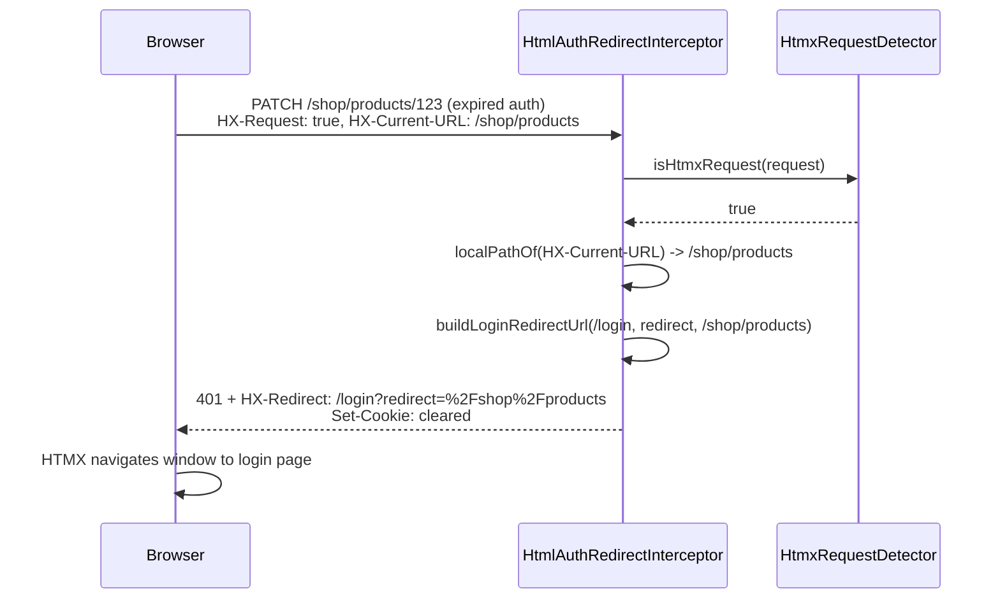

# HTMX Integration

Facet provides first-class [HTMX](https://htmx.org) support for progressive enhancement: start with server-rendered HTML, add partial page updates where needed, and keep pages fast and SEO-friendly. HTMX integration is part of the [interceptor pipeline](architecture.md) — the same response interceptor handles both full pages and fragments.

## Request Detection

`HtmxRequestDetector` identifies HTMX requests by checking HTTP headers:

| Header | Meaning |
|--------|---------|
| `HX-Request: true` | Standard HTMX request marker |
| `HX-Target` | Target element ID for fragment swap |
| `HX-Trigger` | Element that triggered the request |
| `HX-Trigger-Name` | Name of the triggering element |
| `HX-Prompt` | User prompt value |
| `HX-Current-URL` | Current browser URL (for history management) |

`HtmxRequestDetector.isHtmxRequest()` considers a request HTMX when `HX-Request` is present **and** the `Accept` header contains `*/*` (HTMX's default). This is important because HTMX sends `Accept: */*` rather than `Accept: text/html`.

`HtmlResponseHelper.acceptsHtml()` builds on this to decide whether a request is HTML-capable at all:
- Standard browsers: `Accept` contains `text/html`
- HTMX requests: `HX-Request` present + `Accept` contains `*/*` (delegates to `HtmxRequestDetector.isHtmxRequest()`)

`HtmxRequestDetector` also exposes accessors for the other HTMX request headers (`getHxTarget()`, `getHxTrigger()`, `getHxTriggerName()`, `getHxCurrentUrl()`, `getHxPrompt()`) and `isTargeting(request, targetId)`, which normalizes a leading `#` off `HX-Target` before comparing it to a given element id.

Source: [`core/src/main/java/org/facet/html/internal/HtmxRequestDetector.java`](../core/src/main/java/org/facet/html/internal/HtmxRequestDetector.java)

## Fragment Resolution

When an HTMX request includes `HX-Target`, Facet resolves a **fragment template** instead of a full page (see [Template System](template-system.md) for the full resolution algorithm):

```
GET /mydb/products
HX-Request: true
HX-Target: #product-list

Resolution:
1. templates/mydb/products/_fragments/product-list.html
2. templates/_fragments/product-list.html
3. → 500 error (strict mode)
```

`PathBasedTemplateResolver.resolveFragment()` strips the `#` prefix from `HX-Target` before using it as the template filename, then tries exactly two candidates through the shared `resolveTemplate()` routine with `walkHierarchy = false`:

1. `templates/<request-path>/_fragments/<targetId>.html` — resource-specific fragment
2. `templates/_fragments/<targetId>.html` — root fallback fragment

Unlike full-page resolution (which walks up the path hierarchy segment by segment), fragment resolution does **not** walk intermediate parent paths — only the exact resource path and the root fallback are tried. A blank or missing target id short-circuits to an empty result before either candidate is tried.

**Strict mode** is a deliberate design decision: when neither candidate exists, resolution returns empty and the caller surfaces a 500 error rather than silently falling back to a full-page template. This surfaces configuration errors early during development.

Fragment templates are organized in `_fragments/` subdirectories to keep them visually distinct from page templates.

Source: [`PathBasedTemplateResolver.resolveFragment()`](../core/src/main/java/org/facet/templates/PathBasedTemplateResolver.java)

## Server-Side HTMX Response Headers

`HtmxResponseHelper` provides static methods for setting HTMX response headers from custom services or interceptors:

### Client-Side Events

| Method | Header | Purpose |
|--------|--------|---------|
| `triggerEvent(event[, details])` | `HX-Trigger` | Trigger a client-side event immediately (optionally with a JSON details payload) |
| `triggerEventAfterSwap(event[, details])` | `HX-Trigger-After-Swap` | Trigger after DOM swap |
| `triggerEventAfterSettle(event[, details])` | `HX-Trigger-After-Settle` | Trigger after settle |

### Swap Control

| Method | Header | Purpose |
|--------|--------|---------|
| `reswap(swapStyle)` | `HX-Reswap` | Override swap strategy (`innerHTML`, `outerHTML`, `beforeend`, etc.) |
| `retarget(cssSelector)` | `HX-Retarget` | Change the target element |

### Navigation

| Method | Header | Purpose |
|--------|--------|---------|
| `pushUrl(url)` | `HX-Push-Url` | Push URL to browser history |
| `replaceUrl(url)` | `HX-Replace-Url` | Replace current URL (or pass `"false"` to prevent update) |
| `redirect(url)` | `HX-Redirect` | Full client-side redirect |
| `refresh()` | `HX-Refresh` | Force a full page refresh |

Source: [`core/src/main/java/org/facet/html/internal/HtmxResponseHelper.java`](../core/src/main/java/org/facet/html/internal/HtmxResponseHelper.java)

## HTMX-Aware Auth-Failure Redirects

`HtmlAuthRedirectInterceptor` runs at the `REQUEST_AFTER_FAILED_AUTH` intercept point and redirects HTML-capable, unauthenticated requests to a configured `login-uri`. It treats HTMX requests differently from standard browser navigation so that a login redirect does not get swapped into a fragment target:

- **Non-HTMX requests** receive a standard `302 Found` with a `Location` header pointing at the login URL; the original request path and query string are preserved (URL-encoded) as the `redirect` query parameter.
- **HTMX requests** (`HtmxRequestDetector.isHtmxRequest()`) instead receive the login URL in an `HX-Redirect` response header, and the HTTP status code remains **401** (it is not changed to a redirect status). HTMX treats `HX-Redirect` as an instruction to navigate the whole browser window to that URL, rather than swapping the response body into the request's target element — which is exactly what would happen if a 302 were sent for a fragment/action request.
- For HTMX requests, the **redirect target is derived from the `HX-Current-URL` request header**, not from the request's own path. The request path for an HTMX call is typically a fragment or action endpoint (e.g. `PATCH /shop/products/123`) which isn't a navigable page by itself, whereas `HX-Current-URL` carries the full URL of the page the browser was actually displaying when it issued the HTMX request. `HtmlAuthRedirectInterceptor.localPathOf()` parses `HX-Current-URL`, discards scheme/host, and falls back to the raw request path if the header is absent or unparsable.
- In both cases the interceptor removes the `WWW-Authenticate` header and clears the auth cookie (`Set-Cookie: <cookie-name>=; Max-Age=0; ...`) to prevent an infinite redirect loop from a stale/expired token, and sets the response content type to JSON to suppress further body processing.
- The interceptor's `resolve()` only fires for unauthenticated requests that accept HTML (`!request.isAuthenticated() && acceptsHtml(...)`); authenticated-but-unauthorized requests (403) are left untouched — the user keeps their session and auth cookie.
- `exclude-paths` configuration (e.g. API endpoints) bypasses the interceptor entirely for matching path prefixes, HTMX or not.


*HTMX auth-failure flow: status stays 401, and the redirect target comes from `HX-Current-URL` instead of the fragment/action request path.*

Source: [`core/src/main/java/org/facet/html/HtmlAuthRedirectInterceptor.java`](../core/src/main/java/org/facet/html/HtmlAuthRedirectInterceptor.java)

## Mutation Patterns

Facet supports three patterns for handling form submissions and API mutations:

### 1. HTMX Fragment Swap (Recommended)

Use HTMX forms with `hx-post` / `hx-patch` / `hx-delete` and target a fragment:

```html
<form hx-patch="/shop/products/{{ item.data._id }}"
      hx-target="#product-form"
      hx-swap="outerHTML">
  <input name="name" value="{{ item.data.name }}">
  <button>Save</button>
</form>
```

The fragment template re-renders the updated state. No redirect needed — HTMX swaps the DOM directly.

### 2. Post-Redirect-Get

Standard form submission with `302` redirect:

```html
<form method="POST" action="/shop/products">
  <input name="name">
  <button>Create</button>
</form>
```

After POST, redirect to the collection page. Works without JavaScript.

### 3. Inline Response with `requestMethod`

Templates can check `requestMethod` for conditional rendering:

```html

  <div class="success">Product created!</div>

```

`TemplateContextBuilder` always sets `requestMethod` in the template context from `request.getMethod()` (`GET`, `POST`, `PATCH`, `DELETE`, `PUT`, `HEAD`, `OPTIONS`, or `OTHER`), so it is available in every template regardless of which mutation pattern is used.

Source: [`core/src/main/java/org/facet/templates/TemplateContextBuilder.java`](../core/src/main/java/org/facet/templates/TemplateContextBuilder.java), CHANGELOG.md (`requestMethod` added in 1.0.0; "Handling Mutations" guidance).

## SSE Bypass

Server-Sent Events requests (`Accept: text/event-stream`) are explicitly excluded from Facet's HTML interception. `HtmlResponseHelper.isEventStreamRequest()` checks the `Accept` header for `text/event-stream`, and `HtmlResponseInterceptor.resolve()` checks it **before** the `acceptsHtml()` check, returning `false` (bypass) immediately when it matches. This ensures RESTHeart's SSE infrastructure handles the response unchanged. Added to fix issue #8 (see `CHANGELOG.md`, version 1.0.1).

```java
// In HtmlResponseInterceptor.resolve():
if (isEventStreamRequest(request.getHeaders())) {
    return false; // pass through, never intercepted
}
```

Source: [`HtmlResponseInterceptor.java`](../core/src/main/java/org/facet/html/HtmlResponseInterceptor.java), [`HtmlResponseHelper.isEventStreamRequest()`](../core/src/main/java/org/facet/html/internal/HtmlResponseHelper.java)

## Quickstart Template Example

The root `/templates` directory includes a working quickstart with HTMX:

```
templates/
├── index.html              ← home page (global fallback)
├── layout.html             ← base layout (Pico CSS + HTMX CDN)
├── login/index.html        ← login form
└── mydb/products/list.html ← product collection view
```

`layout.html` includes HTMX from CDN (`htmx.org@2.0.8`) and Pico CSS (`@picocss/pico@2`).

## Product Catalog Example

The `examples/product-catalog` demonstrates full HTMX-powered CRUD:

```
templates/
├── _fragments/
│   ├── product-form.html   ← edit form (HTMX fragment)
│   ├── product-list.html   ← product list (HTMX fragment)
│   └── product-new.html    ← create form (HTMX fragment)
├── shop/products/
│   ├── list.html           ← collection page
│   └── view.html           ← document page
├── errors/404.html         ← custom 404 page
├── error.html              ← generic error fallback
└── layout.html             ← shared layout
```

See [`examples/product-catalog/README.md`](../examples/product-catalog/README.md) for the full walkthrough.

## Known Limitation: HX-Reselect

The `HX-Reselect` response header is not implemented in `HtmxResponseHelper`. This minor gap means server-side selection of which part of the response to swap (independent of `hx-select` on the client) is unavailable. It is listed in `CHANGELOG.md` under "Known Limitations (Future Work)" and was first documented as a known gap in the 0.2.0 release; it remains unaddressed as of the current `[Unreleased]` entry.
</content>
