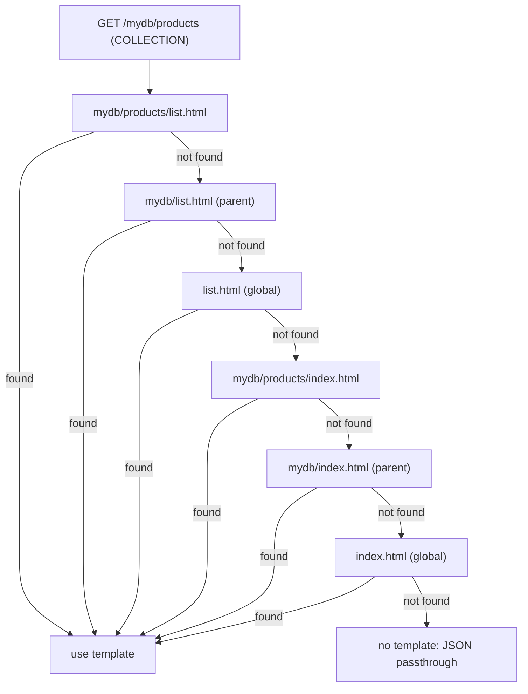
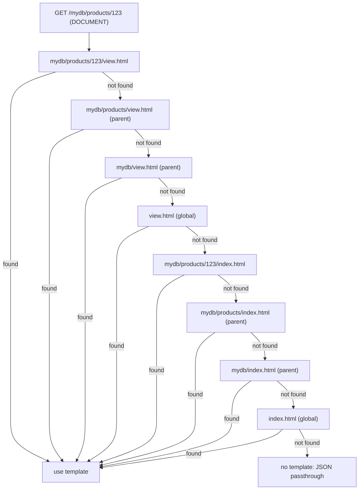
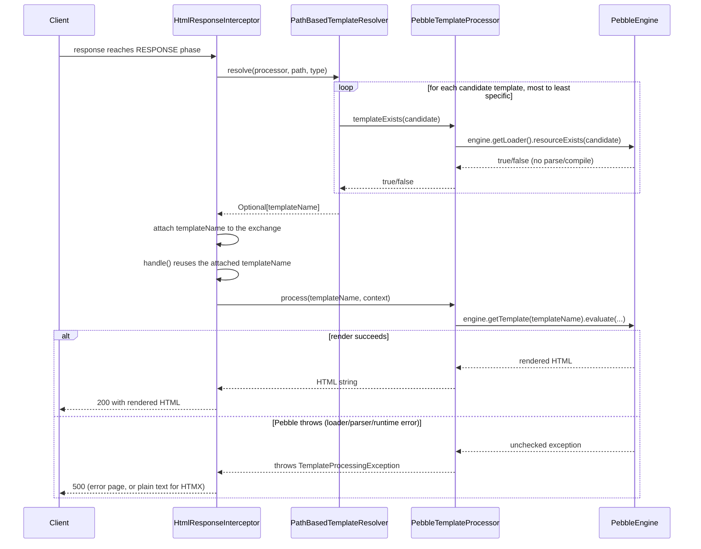

# Template System

Facet uses [Pebble](https://pebbletemplates.io) (a Jinja2/Twig-like template engine) to render HTML. Templates are resolved by **path convention**: the URL structure directly maps to the template directory structure. Template resolution is invoked by the [interceptor pipeline](architecture.md) described in the architecture overview, and is closely tied to [HTMX fragment handling](htmx.md).

## Resolution Algorithm

`PathBasedTemplateResolver` implements two resolution strategies, both built on a single private helper, `resolveTemplate()`, that tries an exact path, then (optionally) walks up the path hierarchy one segment at a time, then tries a root-level fallback.

### Full Page Resolution (`resolve()`)

`resolve(processor, path, type)` maps the request type to an **action template** name — `list` for `COLLECTION`/`ROOT`/`DB`, `view` for `DOCUMENT`, or no action template for other types — and runs the hierarchical lookup for that action template *to exhaustion* (exact path, then each parent segment, then the global root template) **before** falling back to the equivalent hierarchical lookup for `index`. Within each of the two passes, the exact path is tried before any parent segment, and the global root template is the last resort of that pass.

This means the two passes are not interleaved level-by-level: every `list.html`/`view.html` candidate (from most specific to the global one) is exhausted before any `index.html` candidate is tried.

**Collection requests** (e.g., `GET /mydb/products`):


*Hierarchical fallback for a collection request: the `list.html` chain is exhausted before the `index.html` chain is tried.*

**Document requests** (e.g., `GET /mydb/products/123`):


*Hierarchical fallback for a document request: the full `view.html` chain (including every parent segment) is exhausted before the `index.html` chain, which also walks every segment including the document-specific `.../123/index.html`.*

If `requestType` is `null`, `resolve()` falls back to the index-only chain directly (no action-template pass).

### Fragment Resolution (`resolveFragment()`)

HTMX fragment requests (see [HTMX Integration](htmx.md)) use a strict 2-level lookup — `walkHierarchy=false`, so no parent-segment walk happens at all:

```
1. templates/{resource-path}/_fragments/{target-id}.html
2. templates/_fragments/{target-id}.html
3. (not found) → 500 error (strict mode)
```

The `HX-Target` header value (with `#` stripped) determines the fragment filename.

### Request Lifecycle

`HtmlResponseInterceptor` calls the resolver in `resolve()` (the interceptor-selection phase) and reuses the result in `handle()` (the rendering phase), so the hierarchical walk runs once per request:


*`templateExists()` is a cheap loader-only check repeated during the hierarchical walk; `process()` wraps every Pebble exception so a broken template never produces a silent 200 with the raw JSON payload.*

Source: [`PathBasedTemplateResolver.java`](../core/src/main/java/org/facet/templates/PathBasedTemplateResolver.java)

## Naming Conventions

| Template | Use Case | Notes |
|----------|----------|-------|
| `list.html` | Collection views (multiple items) | Recommended — clean, no conditional logic |
| `view.html` | Document views (single item) | Recommended — clear intent |
| `index.html` | Unified fallback | Optional — use when list/view can share logic |
| `_fragments/{id}.html` | HTMX partials | Strict resolution, no hierarchy |
| `errors/{code}.html` | Per-status error pages | e.g., `errors/404.html` |
| `error.html` | Generic error fallback | Used when no status-specific template exists |
| `layout.html` | Base layout | Inherited via `` |

**Why explicit templates?** `list.html` and `view.html` eliminate the need for conditional logic in templates (checking `resourceType` or `items.length`). The filename declares intent, and (per the Resolution Algorithm above) an explicit `list.html`/`view.html` anywhere in the hierarchy is always preferred over any `index.html`, including a more specific `index.html` deeper in the path.

**Template names are extensionless** in resolver calls — Pebble adds `.html` at render time.

## Context Variables

Per-request template context is assembled by `TemplateContextBuilder` together with a response handler (`MongoHtmlResponseHandler` for MongoDB responses, `JsonHtmlResponseHandler` as the generic fallback for other JSON services). A smaller set of **global** variables — shared by every render, independent of the request — are registered once at plugin startup via `TemplateProcessor.addToGlobalTemplateContext()` and are called out explicitly below.

### Authentication

Set by `TemplateContextBuilder.withAuthenticatedUser()`, used by both handlers. Facet always owns these keys: a service JSON response field with the same name can never spoof them.

| Variable | Type | Description |
|----------|------|-------------|
| `isAuthenticated` | `boolean` | `true` if user is logged in |
| `username` | `String` | Current user name (null if not authenticated) |
| `roles` | `Set<String>` | User roles (null if not authenticated) |
| `requestMethod` | `String` | HTTP method: `GET`, `POST`, `PATCH`, `DELETE`, `PUT`, `HEAD`, `OPTIONS` |

### Resource Context

Set by `MongoHtmlResponseHandler.createTemplateContextBuilder()` for MongoDB responses; `path` is also set by `JsonHtmlResponseHandler` for generic JSON responses.

| Variable | Type | Description |
|----------|------|-------------|
| `path` | `String` | Full request path as received, including any mount prefix |
| `mongoPath` | `String` | MongoDB resource path (mount prefix stripped, trailing slash removed) — MongoDB responses only |
| `mongoPrefix` | `String` | MongoDB mount prefix (e.g., `/api` or `/`) — **global**, see provenance note below |
| `resourceType` | `TYPE` | Enum: `ROOT`, `DB`, `COLLECTION`, `DOCUMENT` — MongoDB responses only |

> **`mongoPrefix` provenance:** this is a *global* context variable, not a per-request one. It is computed once by `HtmlResponseInterceptor.onInit()` (from the `mongo-mounts` configuration, via `MongoMountResolver.resolveMongoPrefixFromConfig()`) and registered with `TemplateProcessor.addToGlobalTemplateContext("mongoPrefix", ...)`. `TemplateContextBuilder` never sets it directly; `MongoHtmlResponseHandler` only *reads* it back out of the global context (`getMongoPrefix()`) to compute the per-request `mongoPath`.

### MongoDB Data

Set by `MongoHtmlResponseHandler` (`createTemplateContextBuilder()` and `addPaginationContext()`).

| Variable | Type | Description |
|----------|------|-------------|
| `items` | `List<Map>` | Document objects with `data` (BSON as JSON) and metadata (e.g., ID type) |
| `data` | `String` | JSON string of the full response |
| `page` | `int` | Current page number |
| `pagesize` | `int` | Items per page |
| `totalPages` | `int` | Total page count |
| `totalItems` | `long` | Total document/item count (cached up to 5s per filter, see [Testing](testing.md)) |
| `filter` | `String` | MongoDB filter query parameter |
| `sort` | `String` | Sort query parameter |
| `keys` | `String` | Keys (projection) query parameter |

### Mount Context

Set by `MongoHtmlResponseHandler.resolveMountContext()`, only when the request's `ResolvedContext` (from `MongoMountResolver`) is available.

| Variable | Type | Description |
|----------|------|-------------|
| `db` | `String` | Resolved database name (mount context, falling back to the request's database) |
| `coll` | `String` | Resolved collection name (mount context, falling back to the request's collection) |
| `canCreateDatabases` | `boolean` | Permission flag from the mount context |
| `canCreateCollections` | `boolean` | Permission flag from the mount context |
| `canCreateDocuments` | `boolean` | `true` unless the request targets a `DOCUMENT` resource or no collection is selected |
| `canDeleteDatabase` | `boolean` | Permission flag from the mount context |
| `canDeleteCollection` | `boolean` | Permission flag from the mount context |
| `resourceUrl` | `String` | MongoDB resource path from the mount context |
| `collectionUrl` | `String` | Collection-level URL for navigation (strips the trailing document segment for `DOCUMENT` requests) |

### Tenant Context

Set by `MongoHtmlResponseHandler.addTenantContext()`, derived from hostname-based parametric mounts (`MongoMountResolver.extractTenantId()`).

| Variable | Type | Description |
|----------|------|-------------|
| `tenantId` | `String` | Tenant ID as a JSON-ready value: a quoted string, or the literal `null` |
| `isMultiTenant` | `boolean` | `true` only when the mount context has parametric mounts **and** a tenant ID was resolved |
| `hostParams` | `String` | JSON object of hostname parameters (e.g., `host`, `host[0]`) for tenant resolution |

### HTMX Context

Set by `HtmlResponseInterceptor.handleSuccessResponse()`.

| Variable | Type | Description |
|----------|------|-------------|
| `isHtmxRequest` | `boolean` | `true` if HTMX detected |
| `hxTarget` | `String` | The `HX-Target` value (without `#`), only present when an `HX-Target` header was sent |

### Global variables

Registered once, at `@OnInit`, and shared by every template render regardless of request:

| Variable | Set by | Description |
|----------|--------|-------------|
| `version` | `PebbleTemplateProcessorProvider.onInit()` | Facet/RESTHeart version number |
| `buildTime` | `PebbleTemplateProcessorProvider.onInit()` | Build timestamp |
| `mongoPrefix` | `HtmlResponseInterceptor.onInit()` | MongoDB mount prefix (see provenance note above) |
| `loginUrl` | `LoginService.onInit()` | Mount point of the login service (only when `login-service` is enabled) |
| `rolesUrl` | `LoginService.onInit()` | Roles endpoint for credential submission (only when `login-service` is enabled) |

Source: [`TemplateContextBuilder.java`](../core/src/main/java/org/facet/templates/TemplateContextBuilder.java)

## Custom Pebble Filters

Facet registers four custom filters via `CustomPebbleExtension`:

| Filter | Usage | Example |
|--------|-------|---------|
| `stripTrailingSlash` | Removes trailing `/` (preserves root) | `{{ "/api/db/" \| stripTrailingSlash }}` → `"/api/db"` |
| `buildPath(segment)` | Appends path segment | `{{ "/api/db" \| buildPath("coll") }}` → `"/api/db/coll"` |
| `parentPath` | Returns parent path | `{{ "/api/db/coll/item" \| parentPath }}` → `"/api/db/coll"` |
| `toJson` | Serializes to JSON (pretty by default) | `{{ doc.data \| toJson }}` |

Pebble's own built-in `escape` filter remains available and is required whenever untrusted data is embedded somewhere other than HTML body text — see the security note under **Error Templates** below.

Source files:
- [`StripTrailingSlashFilter.java`](../core/src/main/java/org/facet/templates/pebble/StripTrailingSlashFilter.java)
- [`BuildPathFilter.java`](../core/src/main/java/org/facet/templates/pebble/BuildPathFilter.java)
- [`ParentPathFilter.java`](../core/src/main/java/org/facet/templates/pebble/ParentPathFilter.java)
- [`ToJsonFilter.java`](../core/src/main/java/org/facet/templates/pebble/ToJsonFilter.java)

## Error Templates

`HtmlResponseHelper.renderErrorPage()` installs a custom sender that resolves and renders an error template via `PathBasedTemplateResolver.resolveError()`:

1. `templates/errors/{statusCode}.html` — status-specific page (e.g., `errors/404.html`)
2. `templates/error.html` — generic fallback

If neither template exists, or rendering the resolved template throws `TemplateProcessingException` (or any other `RuntimeException`), `HtmlResponseHelper` returns a minimal built-in HTML page instead, so the browser never sees an empty body. This matters because `templateExists()`/`resolveError()` only check the Pebble loader; an existing-but-broken template (syntax error, missing variable) is only caught when it is actually rendered — see **Template Processing** below. Previously, a missing `error.html`/`errors/{code}.html` could leave the response with an empty HTTP 500 body because Pebble's unchecked `LoaderException` escaped the renderer; this is fixed now that `PebbleTemplateProcessor.process()` wraps every Pebble exception.

An example `errors/404.html` is in the product-catalog example.

**Security note — escaping untrusted values in inline `<script>` content:** any template that embeds a server- or user-controlled string inside inline `<script>` content (not just dedicated error pages — the same rule applies to any login-form-style template) must apply Pebble's `escape(strategy="js")` filter, not the default HTML escaping. The quickstart `templates/login/index.html` does this for the `redirect` value:

```twig
const redirectTo = '{{ redirect | escape(strategy="js") }}' === '/' ? '/' : '{{ redirect | escape(strategy="js") }}';
```

`LoginService.safeRedirect()` already rejects redirect values that are not local absolute paths or that contain characters unsafe for a JS string literal (backslash, quotes, angle brackets, backticks, whitespace, control characters), but that server-side sanitization is a defense-in-depth measure, not a substitute for escaping in the template: any future relaxation of `safeRedirect()`, or any other handler that forwards a less-sanitized value into the same context, would otherwise reopen a script-injection path. Templates must escape untrusted values for the context they are rendered into, regardless of what the service layer already sanitizes.

Source: [`HtmlResponseHelper.java`](../core/src/main/java/org/facet/html/internal/HtmlResponseHelper.java)

## Template Processing

`PebbleTemplateProcessor` wraps the Pebble engine. It is registered as a RESTHeart plugin (`pebble-template-processor`) and configured in `restheart.yml`:

```yaml
/pebble-template-processor:
  enabled: true
  use-file-loader: true
  cache-active: true            # default; set to false to enable hot-reload during development
  templates-path: /opt/restheart/templates
```

`cache-active` genuinely defaults to `true` when the key is omitted — only an explicit `false` disables Pebble's internal template cache (`PebbleTemplateProcessorProvider` parses it with `Boolean.parseBoolean(config.getOrDefault("cache-active", "true").toString())`). Earlier builds silently defaulted to `false` unless the key was present, despite being documented as defaulting to `true`; this is now fixed to match the documentation. The quickstart configuration sets it to `false` explicitly to enable template hot-reload during development.

The processor supports:
- **Global template context** (see Context Variables above), shared across all renders and mutable at runtime via `addToGlobalTemplateContext()`.
- **Locale-aware processing**, configurable via the `locale` key (ISO language tag; defaults to the server locale).
- **Cheap template existence checking** (`templateExists()`): it only asks the Pebble `Loader` whether the resource exists (`engine.getLoader().resourceExists(...)`); it never parses or compiles the template. This makes it safe to call repeatedly — once per candidate — during `PathBasedTemplateResolver`'s hierarchical walk.
- **Hot-reload** when `cache-active: false` (edit templates, refresh browser).

Because `templateExists()` does not compile anything, a template with a Pebble syntax error still reports as "existing" and is selected by the resolver; the syntax error only surfaces when `process()` actually renders it. `PebbleTemplateProcessor.process()` wraps every exception Pebble can throw — loader, parser, and runtime errors, including failures inside custom filters — in a `TemplateProcessingException`, so callers never have to handle Pebble's unchecked exception types directly. `HtmlResponseInterceptor` treats this as a 500 (error page, or plain text for HTMX requests) instead of silently returning the raw JSON payload with a 200 status.

Source: [`PebbleTemplateProcessor.java`](../core/src/main/java/org/facet/templates/pebble/PebbleTemplateProcessor.java), [`PebbleTemplateProcessorProvider.java`](../core/src/main/java/org/facet/templates/pebble/PebbleTemplateProcessorProvider.java)

## When Modifying Template Behavior

- **Change resolution order**: Edit `PathBasedTemplateResolver.resolve()`, `resolveTemplate()`, or `resolveFragment()`.
- **Add a per-request template variable**: Edit `TemplateContextBuilder.withAuthenticatedUser()`, or the relevant response handler's `buildContext()` (`MongoHtmlResponseHandler` or `JsonHtmlResponseHandler`).
- **Add a global template variable**: Call `templateProcessor.addToGlobalTemplateContext(key, value)` from a plugin's `@OnInit` method (see `HtmlResponseInterceptor`, `PebbleTemplateProcessorProvider`, and `LoginService` for examples).
- **Add a new Pebble filter**: Create a class implementing Pebble's `Filter`, register it in `CustomPebbleExtension`.
- **Change caching**: Edit `HtmlResponseHelper.setCachingHeaders()` (HTTP response caching/ETag) or the `cache-active` config key (Pebble's internal template cache).
